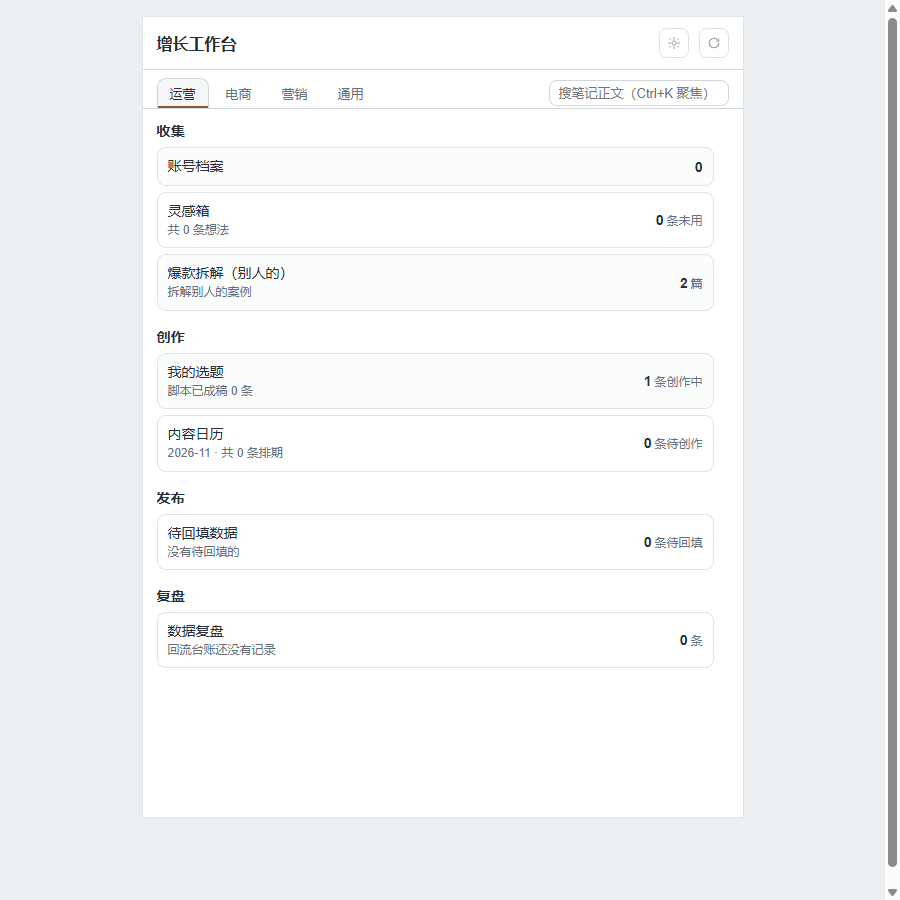
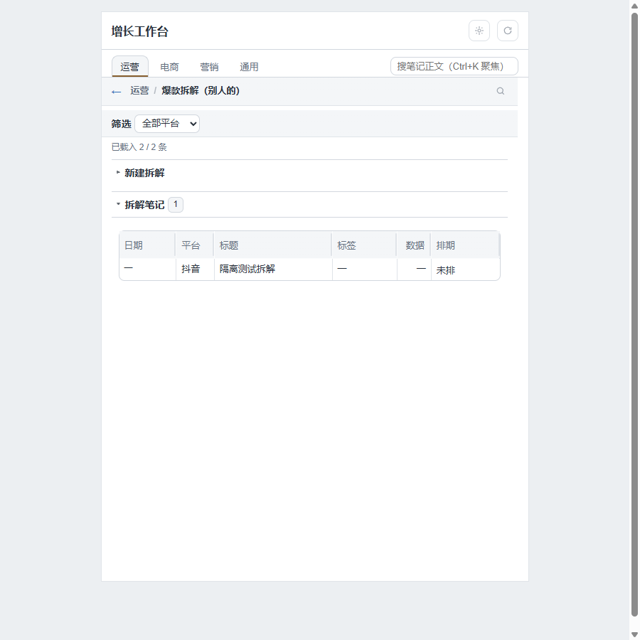
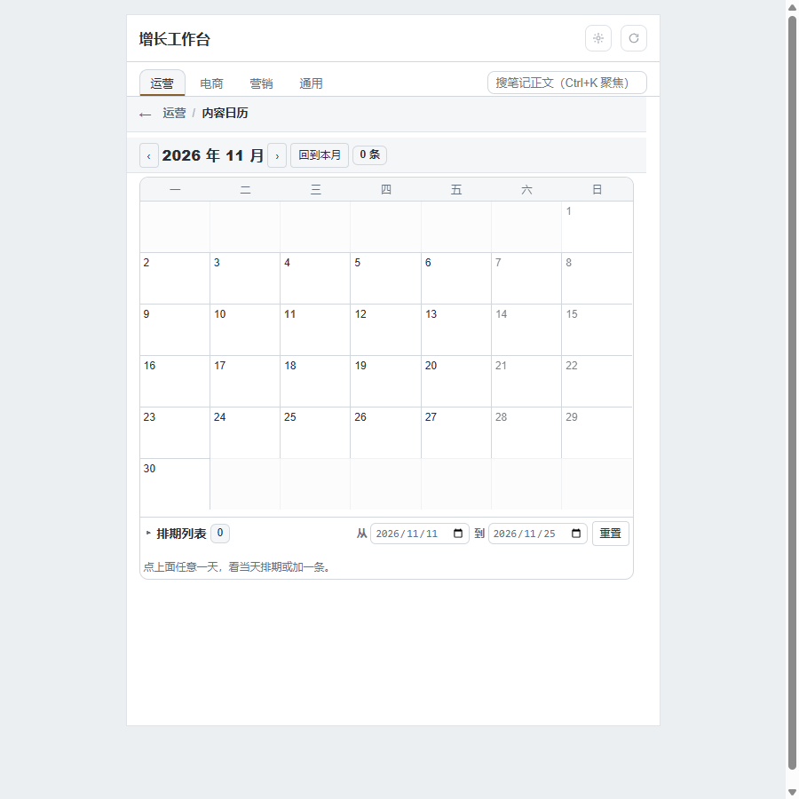

# DSH Growth Workbench

DeepSeek Harness 的内容运营工作台。选题、排期、发布、数据回填和复盘集中在一个侧边栏里，业务数据直接保存在你自己的 Obsidian vault 中。

当前版本 `0.2.0`，仍在快速迭代。项目面向个人创作者和小型内容运营团队，**目前只支持 DSH**，不是 Codex、Claude Code 等通用 Agent 插件。

---

## 目录

- [能做什么](#能做什么)
- [界面预览](#界面预览)
- [内容流程](#内容流程)
- [数据保存在哪里](#数据保存在哪里)
- [环境要求](#环境要求)
- [安装](#安装)
  - [方式一：用安装脚本（推荐）](#方式一用安装脚本推荐)
  - [方式二：让 Agent 帮你装](#方式二让-agent-帮你装)
  - [安装后](#安装后)
- [更新与回滚](#更新与回滚)
- [数据保护](#数据保护)
- [旧数据迁移](#旧数据迁移)
- [Agent 工具](#agent-工具)
- [开发与测试](#开发与测试)
- [主要文件](#主要文件)
- [已知限制](#已知限制)
- [License](#license)

---

## 能做什么

- 管理平台账号、账号定位和目标人群。
- 收集灵感，拆解案例，建立自己的内容选题。
- 为同一选题创建不同平台、不同账号的独立版本。
- 按月排期，也可以一次为多个平台创建版本和日历记录。
- 记录实际发布时间、观察天数和累计数据快照。
- 保存阶段复盘；结案后仍可补录数据或开启新一轮观察。
- 管理商品、客户反馈、营销方案、SOP、术语和文案规则。

## 界面预览

<p align="center">
  
  
  
</p>
<p align="center"><sub>首页 · 选题管理 · 内容日历</sub></p>

每个平台版本独立流转：

```text
在写 → 待发 → 已发 → 待回填 → 已结案
```

发布前可以取消版本。已经发布的内容不会退回“在写”，避免把发布事实和编辑状态混在一起。

“已结案”只表示本轮观察结束，不会锁死数据。之后补录的数据会进入待复核状态，也可以另开一轮观察。“收纳”仅将版本移出日常列表，不改变状态，也不删除文件。

## 数据保存在哪里

工作台没有独立数据库，Markdown 文件就是数据源。默认目录如下：

| 内容 | 目录 |
| --- | --- |
| 账号档案 | `Accounts/` |
| 主选题与案例拆解 | `Topics/` |
| 平台版本 | `Workbench/平台版本/<masterId>/` |
| 内容日历 | `Calendar/YYYY-MM.md` |
| 数据台账 | `Data/回流台账/YYYY-MM.md` |
| 阶段复盘 | `Workbench/复盘结案/<variantId>/` |
| 商品与竞品 | `Products/` |
| 客户反馈 | `Feedback/客户反馈.md` |
| 营销方案 | `Campaigns/` |
| SOP | `SOP/` |
| 文案规则 | `CopyRules/rules.md` |

首次打开工作台时需要填写 vault 根目录。各业务目录可以在设置中修改，插件只管理这个 vault 内的文件。

不同日期的累计数据会分别保留。同一天再次保存时只更新当天记录，不会丢失之前日期的快照。排行榜使用每个版本的最新累计快照，不会把多日累计值重复相加。

## 环境要求

- Windows（其他系统尚未完整验证）
- Node.js `22.19+` 或 `24+`
- DeepSeek Harness `0.2.0-rc.1+`
- 一个可读写的 Obsidian vault

## 安装

安装的本质是：**把插件拷进 DSH 的 desktop profile，并在 profile 的 `package.json` 里把它登记为要加载的 bundle。** 仓库自带 `install.mjs` 脚本，自动完成这件事并备份被改动的配置。

> 注意：安装脚本**不会**安装依赖，也**不会**自动重启 DSH。装完需要你手动重启或重载 DSH。

### 方式一：用安装脚本（推荐）

克隆仓库并进入目录：

```powershell
git clone https://github.com/Neon088/dsh-growth-workbench.git
cd dsh-growth-workbench
```

**先预览**。默认是纯预览，不写任何文件：

```powershell
node install.mjs
```

预览会打印：源目录、目标 profile、要复制的文件数、将改动的 `package.json` 字段。确认无误后，同一次运行内确认并执行：

```powershell
node install.mjs --confirm
```

常用参数：

| 参数 | 作用 |
| --- | --- |
| `--confirm` | 在同一次运行里「预览 + 确认 + 执行」 |
| `--profile <目录>` | 指定非默认的 profile 目录（默认是 `~/.dsh/profiles/desktop`） |
| `--dry-run` | 只预览（默认行为），可与 `--json` 连用输出机器可读的计划 |
| `--json` | 以 JSON 输出预览计划和 64 位 SHA256 指纹 |
| `--apply --expected-plan <指纹>` | 分两次执行：先预览拿指纹，再把这份**已确认**的计划落盘；两次之间源码或配置有变动，指纹失效，必须重新预览 |

指定其他 profile 的完整例子：

```powershell
node install.mjs --profile "D:\DSH\profiles\my-profile" --confirm
```

自动化/CI 里分两步执行（先拿指纹，再按指纹落盘）：

```powershell
node install.mjs --json
node install.mjs --apply --expected-plan <上一步输出的指纹>
```

### 方式二：让 Agent 帮你装

如果你用的就是 DSH 自带的 Agent（或任何能执行命令、读写文件的编码 Agent），可以把下面这段话直接发给它，让它替你把插件装好：

```text
帮我安装 DSH 插件 dsh-growth-workbench（仓库 https://github.com/Neon088/dsh-growth-workbench）。

步骤：
1. 先确认本机 Node 版本 >= 22.19，且存在 DSH desktop profile 目录（默认 ~/.dsh/profiles/desktop）。
2. git clone 仓库到一个临时目录并 cd 进去。
3. 先运行 `node install.mjs` 查看安装预览（这一步不写文件），把预览里的目标 profile 和文件数报告给我确认。
4. 我确认后运行 `node install.mjs --confirm` 完成安装。
5. 如果目标不是默认 profile，用 `--profile <目录>` 指定。
6. 装完不要自动重启 DSH，告诉我需要重启/重载，以及第一次打开工作台时要填写 Obsidian vault 根目录。
7. 如果安装后 DSH 起不来，运行 `node rollback.mjs --confirm` 卸载本插件的注册，再告诉我原因。
```

给 Agent 的关键约束（也请你自己心里有数）：

- **默认纯预览**：不带 `--confirm` 不会改任何东西。让 Agent 先跑一次预览、把结果给你看，再让它确认执行，避免它在没告知你的情况下改配置。
- **改的是 DSH 配置**：脚本会往 profile 的 `package.json` 的 `dsh.profile.bundles` 和 `dependencies` 里登记这个插件，并在 profile 下留一份 `.dsh-growth-backups/` 备份。不要让它手动乱改 `package.json`。
- **失败要能回滚**：DSH 桌面版只要有一个插件加载失败就整个起不来。出问题就跑 `node rollback.mjs --confirm`（或双击 `run-rollback.bat`）卸载本插件的注册；vault 笔记和工作台配置都会保留。
- **vault 由你填**：安装只建目录骨架和空模板，vault 路径在第一次打开工作台时由你自己填。

### 安装后

重新加载或重启 DSH，左侧栏会出现「增长工作台」图标（和「自媒体工作台」「乔木 RSS」并排）。点开后工作台占满主区域，按引导填写 Obsidian vault 根目录，各板块目录骨架会自动创建。

工作台占着主区域时，页面顶部的「打开页内对话」会把这一场会话的原生对话开到工作台自己的右列里，边看工作台边和 agent 说话，不用来回切左栏。这个右列不是 DSH 的右侧栏——右侧栏是每会话一份的独立停靠列，工作台占住主区域时它整列是隐藏的，所以对话直接画在页面里。

## 更新与回滚

更新源码后重新运行安装脚本即可（安装是幂等的，重复跑结果一致）：

```powershell
git pull
node install.mjs --confirm
```

需要撤回插件注册时，先预览回滚计划，再确认执行：

```powershell
node rollback.mjs
node rollback.mjs --confirm
```

回滚只移除本插件的精确注册项，先备份清单/YAML 再隔离插件 entry；**不会**清空整份 Cordis 配置，也**不会**删除你的 Obsidian 笔记和工作台配置（`~/.dsh-growth/config.json`）。安装和回滚产生的配置备份保存在所选 profile 的 `.dsh-growth-backups/`。

## 数据保护

- 修改或删除现有文件前，在 `Workbench/.backups/` 留存备份。
- 保存时检查文件是否已被其他程序修改，发生冲突时拒绝覆盖，让你自己决定。
- 写入过程中使用临时文件替换，避免留下不完整文件。
- 拒绝绝对路径、父目录跳转（`..`）和指向 vault 外部的链接路径；只处理 `.md` 和 `.csv`。
- 事件推送只发送文件指纹，不发送正文内容，客户端收到后自行重读。

这些保护用于降低误写风险，不能替代 vault 自身的版本控制或定期备份。Markdown 表格也不适合多人同时编辑同一份数据。

## 旧数据迁移

设置页中的“v2 数据迁移”可以为旧选题补充稳定 ID，并按平台建立版本。迁移会先预检，只新增所需结构，不删除原笔记，也可以重复运行。

旧状态无法证明内容已经实际发布时，迁移不会擅自创建发布记录。执行前仍建议备份 vault 或提交一次版本控制快照。

## Agent 工具

在 DSH 提供 `tools` 服务时，插件会注册一个名为 `growth_vault` 的对话侧工具。Agent 可以：

- 查看板块（`boards`）和笔记（`list` / `read`）；
- 写入或追加内容（`write` / `append`），合并 frontmatter 字段（`setFront`），或只重写某一个标题下的章节（`replaceSection`）；
- 新建笔记（`create`）和追加 SOP（`sop`）。

该工具使用与工作台相同的路径限制、冲突检查（写回带 `expectedSha1`，文件被改过会拒绝覆盖）和备份机制。发布、结案和观察周期仍在工作台界面中完成。

## 开发与测试

运行离线验证（语法检查 + 未定义引用扫描 + 全部隔离测试）：

```powershell
npm run verify
```

隔离测试使用临时目录，不会读写真实 vault。

浏览器界面测试需要本机已有 React、Playwright 和 Chrome：

```powershell
npm run test:browser
```

测试脚本不会自动下载依赖，也不会连接正在运行的 DSH。隔离浏览器测试通过后，仍需在实际 DSH 主题和窗口尺寸下做一次人工检查。

## 主要文件

| 文件 | 用途 |
| --- | --- |
| `index.js` | DSH 入口、HTTP API、配置和业务编排 |
| `client.js` | 侧边栏界面与交互 |
| `lib/domain.js` | 平台版本、发布、指标和观察周期规则 |
| `lib/vault.js` | 路径限制、冲突检查、备份和文件写入 |
| `lib/table.js` | Markdown 表格读写 |
| `lib/frontmatter.js` | frontmatter 读写 |
| `lib/migrate.js` | 旧数据迁移 |
| `lib/checklist.js` | 发布前风险自检清单 |
| `lib/operational-settings.js` | 运营参数与设置 |
| `lib/agent-tool.js` | `growth_vault` Agent 工具 |
| `lib/profile-maintenance.js` | 安装与回滚（`install.mjs` / `rollback.mjs` 的实际实现） |
| `install.mjs`、`rollback.mjs`、`run-rollback.bat` | 安装、卸载、双击救急 |
| `test/` | 离线测试与浏览器界面测试 |

## 已知限制

- 仅针对 DeepSeek Harness 开发。
- 目前主要在 Windows 上测试。
- 项目仍在快速迭代，更新前请查看提交记录并保留备份。
- 浏览器隔离测试不能代替 DSH 内的实际使用验收。

## License

[MIT](LICENSE)
